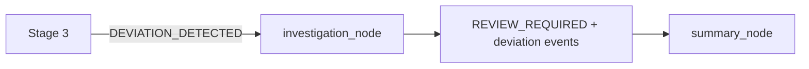
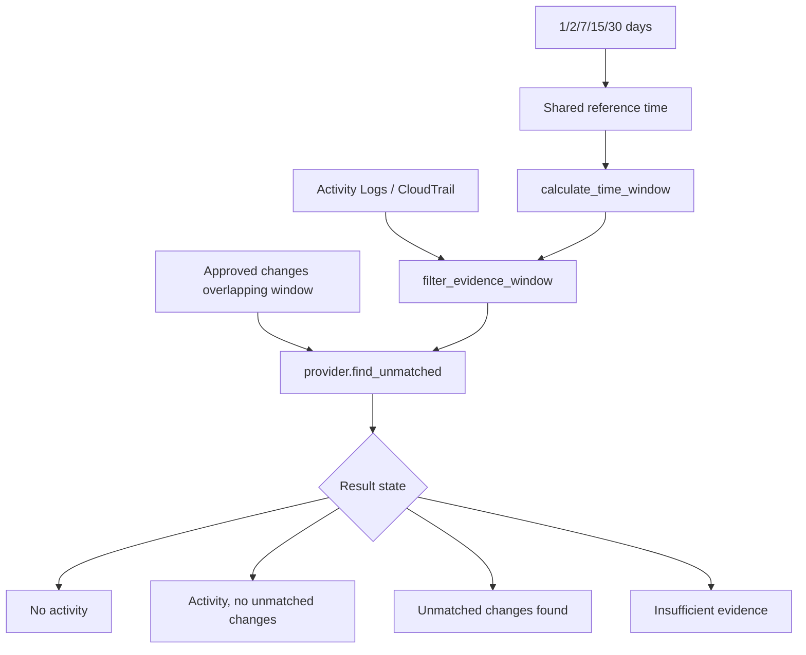

# ARCA Agent 4 — Automated Investigation and Undocumented Changes

## Two implemented paths

“Agent 4” is not a separate conversational agent. The repository implements two related deterministic paths:

1. A lifecycle `investigation` node that packages Stage 3 deviations for review.
2. A direct undocumented-change dashboard that correlates successful modification events with approved change evidence.

## Lifecycle path

`arca/workflow.py:20-24` filters Stage 3 events whose status is `DEVIATION` and returns `REVIEW_REQUIRED`. There is no model call in this node. The following summary node may use the configured narrative provider through `arca.bedrock.explain()`.

## Undocumented-change path

UI handling is `app.py:590-603`. Shared UTC utilities are in `arca/time_filters.py`: `evidence_reference_time()` uses the latest applicable evidence timestamp in demonstration mode and current UTC in live mode; `calculate_time_window()` and `filter_evidence_window()` are reused by dashboard and Ask ARCA tools. Relevant approved changes are retained when their windows overlap the selected period.

Provider correlation is deliberately provider-specific (`arca/providers/azure.py:find_unmatched()` and `arca/providers/aws.py:find_unmatched()`). Azure requires a successful modification event and an exact approved-change match on time, principal, operation, and resource. “Unmatched” means no exact match in available evidence, not confirmed unauthorized activity.

## Evidence preservation

Displayed results retain event IDs, operation names, actors, timestamps, resource IDs, and expandable technical details. No event timestamp is rewritten to make a demonstration appear current. The environment details expose the demonstration reference time.

