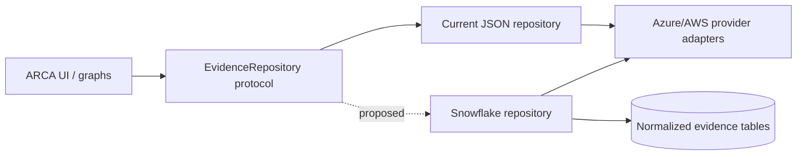

# Proposed Snowflake Integration

## Status

**Proposed only.** No Snowflake dependency, connector, table, query, or credential setting exists in the current repository. The existing application reads local JSON evidence through provider adapters and investigation tools.

## Design objective

Add Snowflake as an evidence-storage/query implementation without changing Azure/AWS evaluation semantics, Pydantic contracts, LangGraph state, or deterministic policy rules.

## Proposed tables

| Table | Natural/evidence key | Important columns |
|---|---|---|
| `CHANGE_EVIDENCE` | provider + change_id | state, environment, implementer IDs, start/end UTC, raw variant |
| `EXPECTED_OPERATION` | change_id + sequence | operation, resource_id |
| `PRIVILEGE_REQUEST` | provider + request_id | principal, role, scope, requested/activation UTC, change_id, raw variant |
| `ROLE_ASSIGNMENT` | provider + assignment_id | principal, role definition, scope, validity UTC |
| `ROLE_DEFINITION` | provider + role_definition_id | management actions, data actions, assignable scopes |
| `RESOURCE_EVIDENCE` | provider + resource_id | subscription/account, group, type, environment, raw variant |
| `ACTIVITY_EVIDENCE` | provider + event_id | timestamp UTC, actor, operation, resource, status, raw variant |

Use `TIMESTAMP_TZ` normalized to UTC, retain raw source payloads in `VARIANT`, and never regenerate source identifiers. Add ingestion metadata (batch ID, source system, received timestamp, synthetic/live flag) without replacing evidence timestamps.

## Minimal application seam

Introduce an `EvidenceRepository` protocol with methods matching current access patterns: bundle loading plus filtered changes, privileges, resources, assignments, roles, and activity. Keep `get_provider('azure'|'aws')` responsible for evaluation. `InvestigationTools` should depend on the repository interface, not issue SQL directly.

Suggested new files (not currently present):

- `arca/repositories/base.py`
- `arca/repositories/json_repository.py`
- `arca/repositories/snowflake_repository.py`
- `config/snowflake.example.env`

## Query and security requirements

- Bind parameters; never interpolate resource names, identities, or dates into SQL.
- Use a read-only role limited to evidence views.
- Store credentials only in environment variables/approved secret facilities; never logs or Git.
- Apply UTC window predicates before correlation and fetch overlapping approved change windows.
- Preserve tenant/account boundaries in every query.
- Return the existing evidence schemas so evaluators remain unchanged.
- Tag result provenance as live or demonstration and expose the reference time.

## Migration sequence

1. Extract the current JSON loading behind the repository protocol with regression tests.
2. Define Snowflake DDL/views and load synthetic fixtures.
3. Implement parameterized repository queries.
4. Run parity tests comparing JSON and Snowflake evidence IDs/outcomes.
5. Add configuration selection and health diagnostics.
6. Pilot read-only live ingestion separately from ARCA evaluation.

This proposal intentionally does not add Snowflake code or modify current runtime behavior.

