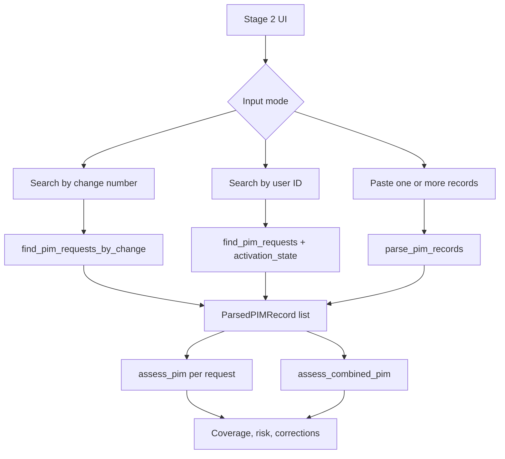

# ARCA Stage 2 — PIM Access Validation

## Purpose

Stage 2 is a standalone recommendation workflow. It evaluates request evidence against an approved change but does not approve, activate, revoke, or combine privileges across different principals.

## Input and retrieval behavior

- The UI is in `app.py:461-537`.
- Change search is the default Azure mode and retrieves every matching request (`arca/pim_validation.py:174-196`). Structured `change_id`/ticket evidence is preferred; justification parsing is fallback evidence.
- User search matches normalized UPN or principal ID and can filter Active, Pending, Scheduled, or All (`arca/pim_validation.py:203-226`). Approved is not treated as active: activation state uses assignments and the reference UTC window.
- Pasted JSON can contain one record, a list, or a wrapper; human-readable parsing is isolated in `parse_pim_record()` / `parse_pim_records()` (`:120-173`). Missing values remain missing.

## Individual deterministic controls

`assess_pim()` (`arca/pim_validation.py:261-339`) evaluates:

1. Change reference consistency and existence.
2. Approved/eligible change state.
3. Principal ID match, with normalized UPN uncertainty where necessary.
4. Catalog role actions against documented operations.
5. Role breadth and resource scope separately.
6. Requested/activation window against the approved change window.
7. Justification consistency.
8. Requested, approved, scheduled, and activated evidence without conflation.

The policy in `config/pim_validation_policy.json` sets zero window tolerance, zero permitted scope levels above the resource, UPN-only escalation, broad roles, and accepted change states.

## Combined evaluation

`assess_combined_pim()` (`arca/pim_validation.py:349-423`) groups coverage by principal, resolves role definitions and scopes, maps documented tasks to supporting request IDs, detects missing tasks, broad permissions/scopes, redundant grants, and overlapping windows, and returns evidence references and human-review requirements. It does not:

- merge two principals into one effective identity;
- assume separate grants can always be replaced with one role;
- invent role definitions or Azure actions;
- mix management-plane `actions` with data-plane `dataActions`.

Supported outcomes are `APPROVE_RECOMMENDED`, `RECOMMEND_LESSER_ROLE`, `OVERPRIVILEGED`, `INSUFFICIENT_ACCESS`, `NEED_MORE_INFO`, and `MANUAL_REVIEW_REQUIRED`.

## Verified demonstration join

`CHG-AZ-2021` links to `pim-az-0021`, `pim-az-0022`, and `pim-az-0023`; the catalog expects `APPROVE_RECOMMENDED` because their resource-scoped catalog roles collectively cover its operations. Other catalog fixtures cover redundant subscription Contributor, missing aggregate coverage, two authorized implementers, and a conflicting change reference.

## Provider behavior

The rich independent workflow is Azure-specific because it uses PIM, Azure role definitions, and RBAC semantics. In AWS mode the Stage 2 UI preserves the existing provider adapter path (`arca/providers/aws.py:evaluate_stage2()`), which evaluates AWS access-request evidence rather than pretending it is Azure PIM.

