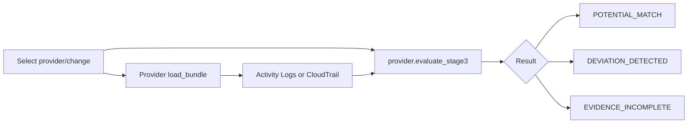

# ARCA Stage 3 — Execution Verification

## Purpose and path

Stage 3 compares approved intent with available execution evidence. It is independently callable from the UI and is also the audit node in the full lifecycle graph.

## Invocation points

- Direct UI: `app.py:544-549`.
- Lifecycle graph audit node: `arca/workflow.py:33,38-40`.
- Azure evaluator: `arca/providers/azure.py:154-175`.
- AWS evaluator: `arca/providers/aws.py:evaluate_stage3()` delegating to the preserved AWS core.

## Azure correlation

The Azure adapter first narrows activity with `_is_relevant()` (`azure.py:134-141`), then compares each event with approved intent. The result retains evidence IDs and timestamps and evaluates operation, target resource, actor, and change window. Matching an operation alone is not proof of execution; correlated evidence returns `POTENTIAL_MATCH`.

Deviation examples include activity outside the approved window, an unexpected engineer, or an unexpected target resource/operation. If no relevant execution evidence exists, the result is `EVIDENCE_INCOMPLETE` rather than success or failure.

## Demonstration examples

- `CHG-AZ-2001` / `az-event-0001`: potential correlation.
- `CHG-AZ-2007`: timing deviation.
- `CHG-AZ-2008`: unexpected actor.
- `CHG-AZ-2009`: unexpected resource modification.
- `CHG-AZ-2021`: future approved change with no execution evidence.

These records are synthetic and their historical UTC timestamps are preserved.

## Boundaries

Stage 3 does not query live resource state, prove application health, or infer success solely from an Activity Log/CloudTrail operation. It does not modify resources. Agent 4 is invoked only by the full lifecycle graph when the Stage 3 status is `DEVIATION_DETECTED`.

