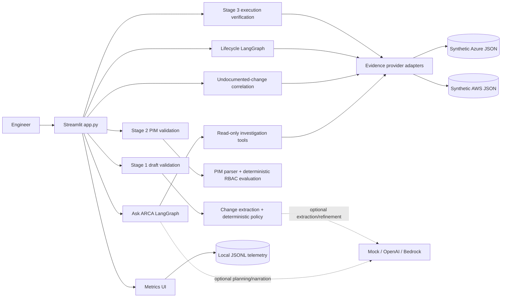
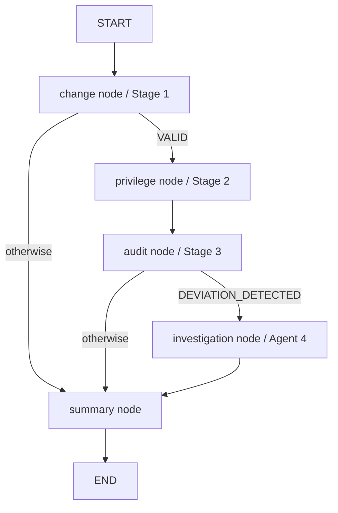

# ARCA Technical Architecture

Implementation-verified against the local source tree on 2026-10-21. This document describes what the application does today; proposed integrations are labelled explicitly.

## System context

ARCA is a Streamlit assurance application for change quality, privileged access, execution evidence, unmatched cloud activity, and conversational investigation. Cloud evidence providers and LLM providers are separate abstractions: selecting Azure or AWS does not select OpenAI, Bedrock, or mock mode.

## Runtime layers

| Layer | Implemented entry points | Responsibility |
|---|---|---|
| Presentation | `app.py`; `arca/observability_ui.py`; `arca/investigation/ui.py` | Navigation, input collection, rendering, session state |
| Orchestration | `arca/workflow.py:build()`; `arca/investigation/agent.py:InvestigationAgent` | Lifecycle routing and checkpointed conversations |
| Deterministic controls | `arca/change_validation.py:validate_draft()`; `arca/pim_validation.py:assess_pim()` / `assess_combined_pim()` | Policy outcomes; LLMs do not approve changes or privileges |
| Provider adapters | `arca/providers/__init__.py:get_provider()`; `azure.py`; `aws.py` | Provider-specific normalization and evaluation |
| LLM adapters | `arca/llm_provider.py:get_llm_provider()` | Mock, OpenAI Responses structured parsing, Bedrock Converse |
| Evidence tools | `arca/investigation/tools.py:InvestigationTools` | Read-only resource, activity, access, PIM, change, and unmatched-event queries |
| Observability | `arca/observability.py`; `arca/observability_ui.py` | JSONL calls, assessments, feedback, errors, spans, filters, exports |
| Evidence | `data/azure/*.json`; `data/{changes,access_requests,events}.json` | Demonstration evidence; not live cloud data |

## Lifecycle graph

Implemented in `arca/workflow.py:28-42`.

The `provider` field in workflow state wins over the `build(provider='aws')` compatibility default. Nodes obtain the adapter with `get_provider()`. The summary calls `arca.bedrock.explain()`, which uses the configured shared LLM provider when enabled and otherwise returns a deterministic mock narrative.

## Ask ARCA graph

Implemented in `arca/investigation/agent.py:34-44`.

This graph has no conditional edges. `plan` produces a Pydantic-validated intent/parameter set; `investigate` uses ordinary Python branches to execute the appropriate read-only tools. `MemorySaver` checkpoints state by `thread_id`. OpenAI can optionally narrate grounded tool results; mock output is explicitly deterministic. See `ARCA_ASK_ARCA_LANGGRAPH.md`.

## Provider-neutral evidence contracts

`arca/providers/schemas.py` defines `ChangeEvidence`, `PrivilegeEvidence`, `ResourceEvidence`, and `ActivityEvidence` TypedDicts. Azure normalization preserves `change_id`, `pim_request_id`, `resource_id`, `event_data_id`, actors, scopes, and UTC timestamps. Azure RBAC evaluation remains provider-specific; it is not treated as AWS IAM.

Current evidence inventory:

- Azure: 25 changes, 29 PIM requests, 29 RBAC assignments, 9 role definitions, 30 resources, 100 Activity Log events.
- AWS-compatible demonstration data: `data/changes.json`, `data/access_requests.json`, and `data/events.json`.
- Demo catalog: 41 verified scenarios in `data/demo_catalog.json`.

## Security and control boundaries

- Investigation tools are read-only and contain no cloud mutation methods.
- Stage results are recommendations/evidence correlations, not approvals or execution actions.
- Stage 3 uses `POTENTIAL_MATCH`, not proof of successful execution, when evidence correlates.
- Unmatched activity is not labelled unauthorized without supporting evidence.
- Structured LLM output is validated with Pydantic; tool parameters reject extra fields.
- `.env` holds local provider configuration and is excluded from Git.
- Synthetic evidence is identified in Environment Details; historical demonstration time uses the latest applicable evidence timestamp.

## Observability

`arca/observability.py` writes local JSONL records for LLM calls, assessments, feedback, errors, and performance spans. It normalizes OpenAI/Bedrock token usage, estimates cost from `config/model_pricing.json`, sanitizes error metadata, and supports combined filters plus CSV export. Metrics rendering is in `arca/observability_ui.py:render_observability()`.

## Implemented, optional, and proposed

- **Implemented:** Streamlit UI, Azure/AWS synthetic adapters, deterministic validation, both LangGraphs, read-only tools, demo catalog, observability.
- **Optional/configured:** OpenAI and Bedrock model calls. Offline tests use mock/fake clients and make no paid calls.
- **Not implemented:** live Azure, AWS, ServiceNow, or Snowflake connectors; infrastructure mutation; automatic approval/submission.
- **Proposed:** Snowflake evidence storage and read-only query adapter described in `ARCA_SNOWFLAKE_INTEGRATION.md`.

